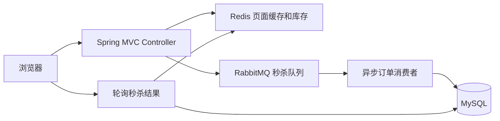

# seckill-demo 秒杀系统

一个基于 Spring Boot 4、MyBatis-Plus、MySQL、Redis、RabbitMQ 和 Thymeleaf 的秒杀演示项目。项目包含商品浏览、手机号登录、秒杀资格校验、Redis 库存预扣减、RabbitMQ 异步下单、秒杀结果轮询和账号设置等功能。

> 本项目用于学习、课程设计和本地演示，不建议直接用于生产环境。

## 功能概览

- 手机号和密码登录，登录成功后通过 `userTicket` Cookie 识别用户。
- 商品列表与商品详情由 Thymeleaf 服务端渲染。
- 商品详情页使用 Redis 缓存渲染后的 HTML；缓存内容不包含用户信息，登录态由 `/user/current` 单独返回。
- 秒杀前申请一次性 `path`，降低直接调用秒杀接口的风险。
- 使用 Redis 原子操作预扣库存，减少数据库瞬时压力。
- 使用 RabbitMQ 异步创建订单，前端轮询查询秒杀结果。
- 使用数据库唯一索引防止同一用户重复购买同一商品。
- 支持修改登录手机号和密码。

## 技术栈

| 组件 | 版本或说明 |
| --- | --- |
| Java | 17+ |
| Maven | 3.9+ |
| Spring Boot | 4.1.1 |
| MyBatis-Plus | 3.5.17 |
| MySQL | 8.x |
| Redis | 6.x 或 7.x |
| RabbitMQ | 3.x 或更高 |
| 前端 | Thymeleaf、原生 JavaScript、CSS |

## 系统流程



秒杀请求的主要过程如下：

1. 前端调用 `GET /seckill/path?goodsId=1` 获取秒杀凭证 `path`。
2. 前端提交 `POST /seckill/doseckill`，参数包含 `goodsid` 和 `path`。
3. 后端校验用户、凭证和重复购买状态。
4. Redis 对 `seckillGoods:{goodsId}` 执行原子递减，完成库存预扣。
5. 扣减成功后，将秒杀消息发送到 `seckillExchange`。
6. 消费者从 `seckillQueue` 接收消息，在事务中扣减数据库库存并创建订单。
7. 前端轮询 `GET /seckill-order/result?goodsId=1` 获取最终结果。

秒杀结果 `data` 的含义：

| 返回值 | 含义 |
| --- | --- |
| 大于 `0` | 秒杀成功，值为订单 ID |
| `0` | 正在排队或仍在处理中 |
| `-1` | 库存不足或未抢到 |

## 项目结构

```text
seckill-demo
├─ sql/
│  └─ seckill.sql                        # MySQL 初始化脚本
├─ src/main/java/com/yr/seckilldemo/
│  ├─ config/                            # Redis、RabbitMQ、MVC 配置
│  ├─ controller/                        # 页面与接口控制器
│  ├─ mapper/                            # MyBatis-Plus Mapper
│  ├─ pojo/                              # 数据实体
│  ├─ rabbitemq/                         # 秒杀消息发送与消费
│  ├─ service/                           # 业务服务
│  ├─ utils/                             # 登录、Cookie、MD5 等工具
│  └─ vo/                                # 返回值和展示对象
├─ src/main/resources/
│  ├─ mapper/                            # MyBatis XML
│  ├─ static/                            # CSS、JavaScript、图片
│  ├─ templates/                         # Thymeleaf 页面
│  └─ application.yml                    # 本地运行配置
└─ pom.xml
```

## 本地运行

### 1. 准备基础服务

请先启动以下服务：

- MySQL，监听 `3306`
- Redis，监听 `6379`
- RabbitMQ，监听 `5672`

### 2. 初始化数据库

创建数据库并导入项目自带的 SQL：

```sql
CREATE DATABASE IF NOT EXISTS seckill
    CHARACTER SET utf8mb4
    COLLATE utf8mb4_0900_ai_ci;
```

Windows PowerShell 可以使用：

```powershell
mysql -uroot -p -e "CREATE DATABASE IF NOT EXISTS seckill CHARACTER SET utf8mb4 COLLATE utf8mb4_0900_ai_ci;"
cmd /c "mysql -uroot -p seckill < sql\seckill.sql"
```

Linux 或 macOS 可以使用：

```bash
mysql -u root -p -e "CREATE DATABASE IF NOT EXISTS seckill CHARACTER SET utf8mb4 COLLATE utf8mb4_0900_ai_ci;"
mysql -u root -p seckill < sql/seckill.sql
```

脚本默认创建以下表：

| 表名 | 作用 |
| --- | --- |
| `goods` | 商品基础信息 |
| `t_seckill_goods` | 秒杀商品、秒杀价格、库存和时间 |
| `t_order` | 普通订单 |
| `t_seckill_order` | 秒杀订单关联 |
| `t_user` | 用户信息 |

### 3. 修改配置

配置文件位于 `src/main/resources/application.yml`。默认值如下：

| 配置项 | 默认值 |
| --- | --- |
| MySQL 地址 | `localhost:3306/seckill` |
| MySQL 用户 | `root` |
| MySQL 密码 | `123456` |
| Redis 地址 | `localhost:6379` |
| Redis 数据库 | `1` |
| RabbitMQ 地址 | `192.168.10.5:5672` |
| RabbitMQ 用户 | `guest` |
| RabbitMQ 密码 | `guest` |

如果 RabbitMQ 不在 `192.168.10.5`，必须修改 `spring.rabbitmq.host`。也可以使用 Spring Boot 支持的环境变量覆盖配置，例如：

```powershell
$env:SPRING_RABBITMQ_HOST = "localhost"
$env:SPRING_DATASOURCE_PASSWORD = "你的MySQL密码"
$env:SPRING_DATA_REDIS_HOST = "localhost"
mvn spring-boot:run
```

### 4. 启动应用

```bash
mvn spring-boot:run
```

或者先打包再运行：

```bash
mvn clean package -DskipTests
java -jar target/seckill-demo-0.0.1-SNAPSHOT.jar
```

启动后访问：

```text
http://localhost:8080/goods/toDetail
```

SQL 脚本中包含的演示账号：

| 手机号 | 密码 |
| --- | --- |
| `13669255555` | `123456` |
| `13669255556` | `123456` |

## 主要接口

| 方法 | 路径 | 参数 | 说明 |
| --- | --- | --- | --- |
| `GET` | `/tologin` | 无 | 登录页面 |
| `POST` | `/api/login` | `id`、`password` | 登录并写入 `userTicket` Cookie |
| `GET` | `/goods/toDetail` | 无 | 商品列表页面 |
| `GET` | `/goods/toList/{goodsid}` | 路径参数 `goodsid` | 商品详情页面 |
| `GET` | `/user/current` | Cookie | 返回当前登录用户昵称，用于填充缓存页面的 header |
| `GET` | `/user/settings` | Cookie | 账号设置页面 |
| `POST` | `/user/updatePassword` | `password` | 修改密码 |
| `POST` | `/user/updateId` | `id` | 修改登录手机号 |
| `GET` | `/seckill/path` | `goodsId` | 获取秒杀凭证 |
| `POST` | `/seckill/doseckill` | `goodsid`、`path` | 提交秒杀请求 |
| `GET` | `/seckill-order/result` | `goodsId` | 查询秒杀结果 |

接口统一返回以下结构：

```json
{
  "code": 200,
  "msg": "成功",
  "data": null
}
```

登录成功后，浏览器会保存 `userTicket` Cookie。使用 `curl` 或压测工具调用需要登录的接口时，需要同步传递该 Cookie。

## 压测说明

课程工作区中提供了 JMeter 脚本，例如：

- `../聚合报告.jmx`
- `../Config/聚合报告.jmx`
- `../apache-jmeter-5.6.3/商品列表.jmx`

这些脚本默认访问 `localhost:8080`，并使用 CSV 提供用户 Cookie。压测前需要确保 MySQL、Redis、RabbitMQ 和应用都已启动，同时根据机器配置调整线程数、循环次数和连接池大小。

## 已知限制

当前代码更偏向教学演示，部署或继续开发前建议处理以下问题：

- RabbitMQ 地址、数据库密码等敏感配置硬编码在 `application.yml` 中。
- `/user/info` 当前没有添加 `@ResponseBody`，不应当作为可用的 JSON 接口。
- 库存售罄标记使用 JVM 内的 `Map`，不适用于多实例部署。
- 应用启动时会用数据库库存覆盖 Redis 库存，重启时在途的预扣会丢失。
- Redis 预扣库存和数据库最终扣减不是同一个分布式事务，消息或数据库异常时需要补充补偿逻辑。
- 密码使用 MD5 加盐，仅适合演示。真实系统应使用 BCrypt、Argon2 等密码哈希算法。
- `pom.xml` 中 `spring-boot-starter-data-redis` 声明了两次，Maven 会产生重复依赖警告。

## 后续可扩展方向

- 使用消息确认、死信队列和定时任务补偿失败订单。
- 将秒杀库存、用户购买记录和限流逻辑集中到 Redis Lua 脚本。
- 增加订单中心、支付流程和后台管理页面。
- 将配置迁移到环境变量或配置中心，并移除仓库中的明文密码。
- 补充单元测试、集成测试和自动化压测报告。
