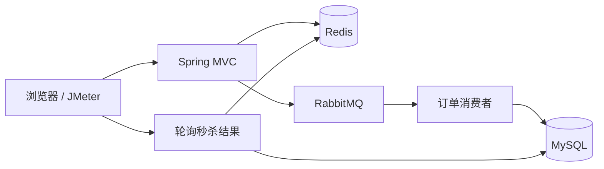

# seckill-demo 秒杀系统

一个基于 Spring Boot 4、MyBatis-Plus、MySQL、Redis、RabbitMQ 和 Thymeleaf 的秒杀系统。

项目覆盖了秒杀场景的完整链路：登录鉴权、秒杀凭证、Redis 库存预扣、消息队列异步下单、秒杀结果轮询，以及账号设置。

> 本项目用于学习、课程设计和本地演示，不建议直接用于生产环境。

## 功能概览

- 手机号和密码登录，登录成功后通过 `userTicket` Cookie 识别用户。
- 商品列表与商品详情由 Thymeleaf 服务端渲染。
- 商品详情页使用 Redis 缓存渲染后的 HTML，缓存内容不包含用户信息，登录态由 `/user/current` 单独返回。
- 秒杀前申请一次性 `path` 凭证，降低直接调用秒杀接口的风险。
- 使用 Redis Lua 脚本原子完成「判断库存 + 扣减库存」，库存不会扣成负数。
- 使用 RabbitMQ 异步创建订单，前端轮询查询秒杀结果。
- 消费端按异常类型分别处理，失败消息进入死信队列。
- 使用数据库唯一索引防止同一用户重复购买同一商品。
- 支持修改登录手机号和密码，修改密码需要校验原密码。

## 技术栈

| 组件 | 版本或说明 |
| --- | --- |
| Java | 17+（JDK 23 下验证过虚拟线程） |
| Maven | 3.9+ |
| Spring Boot | 4.1.1 |
| MyBatis-Plus | 3.5.17 |
| MySQL | 8.x |
| Redis | 6.x / 7.x |
| RabbitMQ | 3.12.x |
| 监控 | Spring Boot Actuator + Micrometer + Prometheus |
| 压测 | JMeter 5.6.3 |
| 前端 | Thymeleaf、原生 JavaScript、CSS |

## 系统架构



### 请求路径与异步路径

秒杀请求的同步路径**不访问 MySQL**，只依赖 Redis 和 RabbitMQ：

```text
GET  /seckill/path
  └─ Redis: SET createPath:{userId}:{goodsId}

POST /seckill/doseckill
  ├─ Redis: GET  user:{token}
  ├─ Redis: GET  createPath:{userId}:{goodsId}
  ├─ Redis: GET  order:{userId}:{goodsId}
  ├─ Redis: EVAL 原子扣减库存
  └─ RabbitMQ: 发送 seckillMessage
  └─ 立即返回 0（排队中）

异步消费者
  ├─ MySQL: UPDATE t_seckill_goods SET stock_count = stock_count - 1
  ├─ MySQL: INSERT t_order
  └─ MySQL: INSERT t_seckill_order
```

秒杀请求的主要过程：

1. 前端调用 `GET /seckill/path?goodsId=1` 获取秒杀凭证 `path`。
2. 前端提交 `POST /seckill/doseckill`，参数包含 `goodsid` 和 `path`。
3. 后端校验用户、凭证和重复购买状态。
4. Redis 执行 Lua 脚本，原子完成库存判断与扣减。
5. 扣减成功后，将消息发送到 `seckillExchange`。
6. 消费者从 `seckillQueue` 接收消息，在事务中扣减数据库库存并创建订单。
7. 前端轮询 `GET /seckill-order/result?goodsId=1` 获取最终结果。

秒杀结果 `data` 的含义：

| 返回值 | 含义 |
| --- | --- |
| 大于 `0` | 秒杀成功，值为订单 ID |
| `0` | 正在排队或仍在处理中 |
| `-1` | 库存不足或未抢到 |

## 核心设计

### 1. Redis Lua 原子扣库存

库存判断和扣减在一次 Lua 调用中完成，避免 `decrement` 后再补偿的非原子问题：

```lua
local stock = redis.call('get', KEYS[1])
if stock == false then return -1 end
if tonumber(stock) <= 0 then return -1 end
return redis.call('decr', KEYS[1])
```

| 返回值 | 含义 |
| --- | --- |
| `-1` | 库存不足或 key 不存在 |
| `>= 0` | 扣减成功，值为剩余库存 |

并发验证：初始库存 5，100 个并发请求，最终成功 5 次、库存为 0，未出现负数。

### 2. 秒杀凭证 path

- `createSeckillPath` 与 `checkPath` 使用同一个 key 构建方法，避免读写 key 不一致。
- 凭证写入 Redis 并设置 5 分钟过期。

### 3. 消息体最小化

消息体只包含 `userId` 和 `goodsId`：

```json
{"userId":13000000000,"goodsId":1}
```

不传递完整的 `User` 对象，避免密码哈希进入消息队列和日志。

### 4. 异常分类与死信队列

消费者按异常类型处理：

| 异常 | 处理方式 |
| --- | --- |
| 消息格式错误 | 记录日志后丢弃 |
| `DuplicateKeyException` | 重复购买，记录日志后忽略 |
| `GlobalException` | 库存不足等业务失败，记录日志后忽略 |
| 其他基础设施异常 | 向上抛出，进入死信队列 |

`seckillQueue` 配置了死信交换机 `seckillDlxExchange`，失败消息进入 `seckillDlQueue`。

### 5. 页面缓存与用户态解耦

商品页整体缓存，缓存内容与用户无关；登录态通过 `/user/current` 单独获取并填充 header，避免不同用户看到彼此的用户名。

## 项目结构

```text
seckill-demo
├─ loadtest/                              # JMeter 脚本、压测结果、重置脚本
├─ sql/
│  └─ seckill.sql                         # MySQL 初始化脚本
├─ src/main/java/com/yr/seckilldemo/
│  ├─ config/                             # Redis、RabbitMQ、MVC 配置
│  ├─ controller/                         # 页面与接口控制器
│  ├─ exception/                          # 全局异常处理
│  ├─ mapper/                             # MyBatis-Plus Mapper
│  ├─ pojo/                               # 数据实体
│  ├─ rabbitemq/                          # 秒杀消息发送与消费
│  ├─ service/                            # 业务服务
│  ├─ utils/                              # Cookie、MD5、压测数据生成等工具
│  └─ vo/                                 # 返回值和展示对象
├─ src/main/resources/
│  ├─ mapper/                             # MyBatis XML
│  ├─ static/                             # CSS、JavaScript、图片
│  ├─ templates/                          # Thymeleaf 页面
│  └─ application.yml                     # 本地运行配置
├─ ROADMAP.md                             # 技术债与后续计划
└─ pom.xml
```

## 本地运行

### 1. 准备基础服务

- MySQL，监听 `3306`
- Redis，监听 `6379`
- RabbitMQ，监听 `5672`

### 2. 初始化数据库

```sql
CREATE DATABASE IF NOT EXISTS seckill
    CHARACTER SET utf8mb4
    COLLATE utf8mb4_0900_ai_ci;
```

```powershell
mysql -uroot -p -e "CREATE DATABASE IF NOT EXISTS seckill CHARACTER SET utf8mb4 COLLATE utf8mb4_0900_ai_ci;"
cmd /c "mysql -uroot -p seckill < sql\seckill.sql"
```

脚本创建以下表：

| 表名 | 作用 |
| --- | --- |
| `goods` | 商品基础信息 |
| `t_seckill_goods` | 秒杀商品、秒杀价格、库存和时间 |
| `t_order` | 订单 |
| `t_seckill_order` | 秒杀订单关联（`user_id + goods_id` 唯一索引） |
| `t_user` | 用户信息 |

### 3. 配置

`application.yml` 中的敏感配置支持环境变量覆盖：

| 环境变量 | 默认值 |
| --- | --- |
| `DB_USERNAME` | `root` |
| `DB_PASSWORD` | `123456` |
| `RABBITMQ_HOST` | `192.168.10.5` |
| `RABBITMQ_USERNAME` | `guest` |
| `RABBITMQ_PASSWORD` | `guest` |

```powershell
$env:DB_PASSWORD = "你的MySQL密码"
$env:RABBITMQ_HOST = "localhost"
mvn spring-boot:run
```

### 4. 启动应用

```bash
mvn spring-boot:run
```

或先打包：

```bash
mvn clean package -DskipTests
java -jar target/seckill-demo-0.0.1-SNAPSHOT.jar
```

启动后访问：

```text
http://localhost:8080/goods/toDetail
```

SQL 脚本中的演示账号：

| 手机号 | 密码 |
| --- | --- |
| `13669255555` | `123456` |
| `13669255556` | `123456` |

### 5. 可观测性

应用启动后可通过 Actuator 查看指标：

```text
http://localhost:8080/actuator/prometheus
```

主要指标：

| 指标 | 含义 |
| --- | --- |
| `http_server_requests_seconds_*` | 各接口请求数与耗时 |
| `jvm_gc_pause_seconds_*` | GC 次数与停顿 |
| `process_cpu_usage` | 进程 CPU 占用 |
| `hikaricp_connections_*` | 数据库连接池状态 |
| `seckillExchange_seconds_*` | RabbitMQ 发布耗时（含排队） |
| `spring_rabbit_template_seconds_*` | RabbitMQ 实际发送耗时 |

## 主要接口

| 方法 | 路径 | 参数 | 说明 |
| --- | --- | --- | --- |
| `GET` | `/tologin` | 无 | 登录页面 |
| `POST` | `/api/login` | `id`、`password` | 登录并写入 `userTicket` Cookie |
| `GET` | `/goods/toDetail` | 无 | 商品列表页面 |
| `GET` | `/goods/toList/{goodsid}` | 路径参数 `goodsid` | 商品详情页面 |
| `GET` | `/user/current` | Cookie | 返回当前登录用户昵称，用于填充缓存页面 header |
| `GET` | `/user/settings` | Cookie | 账号设置页面 |
| `POST` | `/user/updatePassword` | `oldPassword`、`password` | 修改密码，需校验原密码 |
| `POST` | `/user/updateId` | `id` | 修改登录手机号 |
| `GET` | `/seckill/path` | `goodsId` | 获取秒杀凭证 |
| `POST` | `/seckill/doseckill` | `goodsid`、`path` | 提交秒杀请求 |
| `GET` | `/seckill-order/result` | `goodsId` | 查询秒杀结果 |

接口统一返回：

```json
{
  "code": 200,
  "msg": "成功",
  "data": null
}
```

登录成功后，浏览器会保存 `userTicket` Cookie。使用 `curl` 或压测工具调用需要登录的接口时，需要同步传递该 Cookie。

## 压测与验证

### 脚本

压测脚本位于 `loadtest/seckill.jmx`，每轮流程包含两个请求：

1. `GET /seckill/path`
2. `POST /seckill/doseckill`

脚本通过 CSV 读取 `config.txt` 中的 `userId,ticket`，并用 JSON 断言检查响应的 `$.code`。

### 前置数据

压测前需要：

1. 停止应用
2. 重置数据库与 Redis（使用 `loadtest/reset-data.ps1` 或手动执行）
3. 启动应用，确认 Redis 库存为 3000
4. 运行 `UserUtils` 生成 ticket，确认 `config.txt` 为 5000 行

### 实测结果

在 500 线程、ramp-up 2 秒、循环 4 次（共 2000 次秒杀流程）、库存 3000 的条件下：

| 指标 | `channel.size = 25`（默认） | `channel.size = 450` |
| --- | --- | --- |
| RabbitMQ 发布平均耗时 | 620ms | 35ms |
| `POST /seckill/doseckill` 服务端平均 | 673ms | 241ms |
| 错误率 | 0% | 0% |

优化点：`spring.rabbitmq.cache.channel.size` 默认只有 25 个缓存 channel，500 并发下发布消息需要排队。将缓存提升到 450 后，发布耗时下降约 94%。

### 一致性验证

压测结束后同时检查：

| 项目 | 结果 |
| --- | --- |
| 订单数 | 2000 |
| 数据库库存 | 1000 |
| Redis 库存 | 1000 |
| 差异 | 0 |

### 故障演练

压测过程中 RabbitMQ 所在主机曾掉线，2000 个请求全部超时。主机恢复后，持久化队列和发布重试使消息最终全部被消费，Redis 与数据库库存恢复一致。该场景暴露了「Redis 预扣与数据库落库不是原子操作」的风险，已记录在 `ROADMAP.md`。

## 已知限制

完整清单见 [ROADMAP.md](ROADMAP.md)，主要包括：

- 查重与库存扣减尚未合并进同一个 Lua 脚本，同一用户并发提交时仍可能重复预扣。
- 消费失败时 Redis 库存没有主动回补，需要依赖对账任务修复。
- 应用启动时会用数据库库存覆盖 Redis 库存，重启时在途预扣会丢失。
- 密码使用 MD5 加盐，仅适合演示。
- 修改密码后只失效当前会话，其他设备的会话仍然有效。

## 相关文档

- [ROADMAP.md](ROADMAP.md)：技术债、优先级与后续计划
- `loadtest/`：JMeter 脚本、压测结果与数据重置脚本
